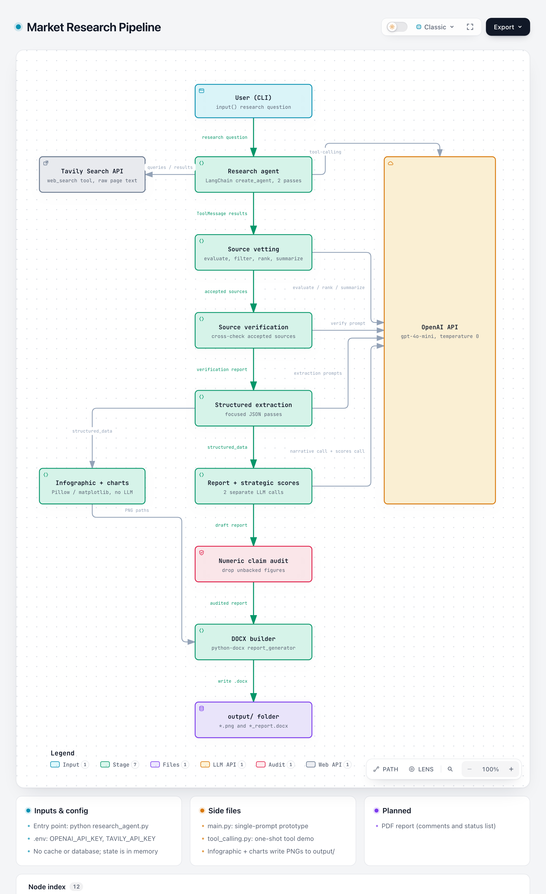

# Market Research Agent

A command-line tool that researches a company and writes a branded Word report about it. You type a company name; it searches the web, has an LLM vet and summarise the sources, extracts the facts into structured data, and produces a `.docx` report with an infographic, charts, a SWOT table and a linked list of sources.

It uses OpenAI's `gpt-4o-mini` through LangChain for every LLM step, and the Tavily Search API for web search.

## How it works



| Stage | Where it lives | Uses an LLM |
| --- | --- | --- |
| Read the research question from the terminal | `research_agent.py` | No |
| Two research passes (broad, then primary financial sources) with a LangChain agent | `research_agent.py`, `tools/web_search.py` | Yes, plus Tavily |
| Evaluate, filter, rank and summarise each source | `research_agent.py` | Yes (filtering is rule-based) |
| Cross-check the accepted sources | `research_agent.py` | Yes |
| Extract structured data (financials, segments, customers, competitors, timeline) | `research_agent.py` | Yes |
| Draw the company snapshot infographic | `infographic.py` (Pillow) | No |
| Draw charts, only where the data supports one | `charts.py` (matplotlib) | No |
| Write the narrative report and the strategic scores | `research_agent.py` | Yes, two separate calls |
| Delete narrative sentences whose numbers don't match the extracted data | `research_agent.py` | No |
| Build the Word document | `report_generator.py` (python-docx) | No |

Everything is held in memory during a run. There is no database or cache.

## Requirements

- Python 3.10 or newer (developed and tested on 3.10.12)
- An OpenAI API key
- A Tavily API key

## Setup

```bash
git clone <repo-url>
cd <repo-folder>
python3 -m venv .venv
source .venv/bin/activate
pip install -r requirements.txt
cp .env.example .env
```

Then fill in the two keys in `.env`:

| Variable | Used for |
| --- | --- |
| `OPENAI_API_KEY` | Every LLM step (`gpt-4o-mini`) |
| `TAVILY_API_KEY` | Web search |

## Running it

```bash
source .venv/bin/activate
python research_agent.py
```

It asks one question:

```
What would you like to research? Garmin Ltd.
```

Type a company name. The prompts are written for researching a company (annual reports, segments, competitors), so a company name works better than a general market question.

The run prints each stage to the terminal and takes around 10 minutes. When it finishes, `output/` holds:

- `<Company>_market_research_report.docx`, the report
- `<company>_executive_dashboard.png`, the snapshot infographic
- one PNG per chart that had enough data

The file name comes from the company name the LLM extracts from the sources, not from what you typed.

`main.py` and `tool_calling.py` are early prototypes: a single-prompt overview, and a one-shot tool-calling demo. They aren't part of the pipeline.

## Scope and limitations

This is a working prototype, not a finished product.

### Tested on

| Company | Report | Images produced |
| --- | --- | --- |
| Garmin Ltd. | Full | 13: dashboard, timeline, five-year and quarterly revenue, outlook, segment revenue and growth, geography, market size and composition, competitors, customers, employees |
| Apple Inc. | Full | 8: dashboard, timeline, five-year revenue, segments, geography, market size, customers, employees |
| Snowflake Inc. | Full | 5: dashboard, timeline, five-year revenue, customers, employees |
| Private company A | Thin | 2: dashboard and timeline only |
| Private company B | Thin | 2: dashboard and timeline only |

Large listed companies with annual reports online give the richest reports. Private companies with little published financial data get a short report with few or no charts. The tool doesn't invent figures to fill the gaps.

### Known rough edges

- **Only the narrative is audited.** The numeric audit removes narrative sentences whose figures can't be matched to the extracted data, but the strategic scores and the infographic don't go through it. In the Snowflake run, the score explanations and the snapshot still showed figures that the audit had removed from the text.
- **Extraction mistakes reach the report.** Examples from the Snowflake run: a "Gross Profit $0.0M" placeholder, and new customers in a quarter labelled as total customers. Check the figures before relying on a report.
- **A run with no usable sources still writes a report.** If every search fails or every source is rejected, the run still produces a near-empty `Market_Research_market_research_report.docx` that only says no sources were available.
- **No caching or resume.** Every run repeats all OpenAI and Tavily calls, which costs API credit each time, and a crash partway through means starting again.
- **One script, run top to bottom.** `research_agent.py` runs the whole pipeline when started. There are no command-line options, no importable entry point, and no tests.
- **Unpinned, oversized requirements.** `requirements.txt` has no version pins. It also includes packages the code doesn't import (`langchain-anthropic`, `langchain-google-genai`, `google-generativeai`, `langchain-huggingface`, `transformers`, `huggingface-hub`, `numpy`, `scikit-learn`), which make the install much larger.
- **Word output only.** PDF export is planned but not built.
- **Search failures are quiet.** If a Tavily call fails (bad key, quota used up), the tool prints a warning and carries on with no results for that query, so a bad key can produce a thin report rather than an error.

## License

[MIT](LICENSE)
